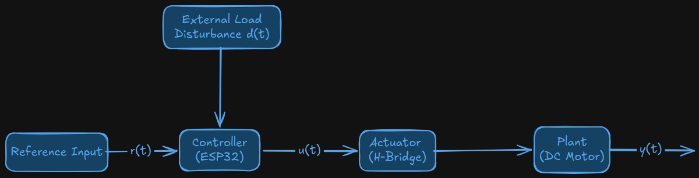
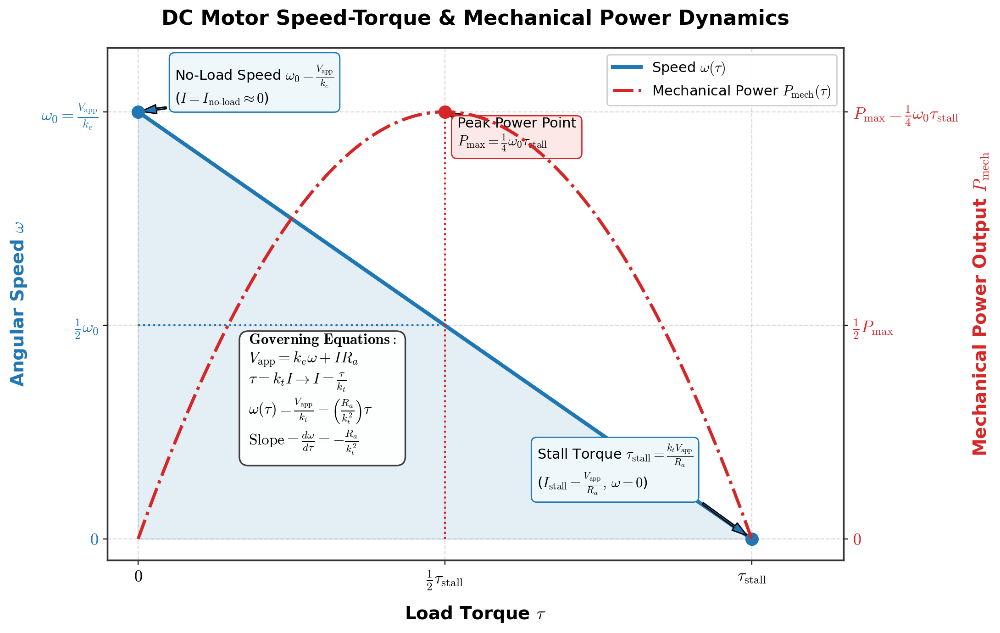
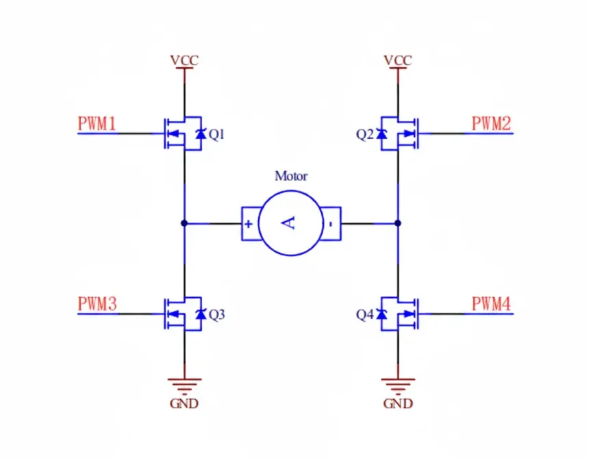
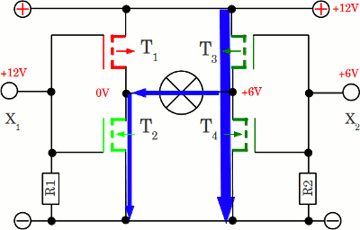
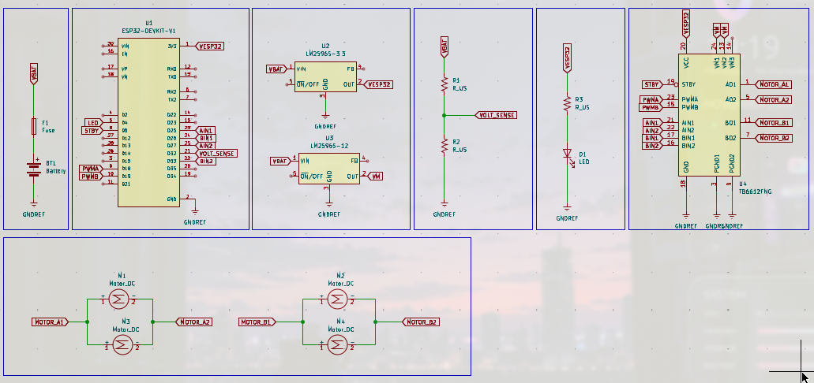

By: >_ terminal_gremlin (c-lydia^-^)  
Chheng Lydiya

## Introduction to Control System and Open-Loop Motion Framework

### The Architecture of Control System

A control system is an engineering framework designed to regulate, command, or direct the physical behavior of a system (referred to as the **plant**) to achieve a desired output response over time. In physical robotics, the control system bridges the gap between digital software algorithms running on a microcontroller and physical mechanical motion across a mobile chassis.

The operation of any robotic control system is defined across four foundational functional blocks:

1. **Reference Input ($r(t)$):** the target state commanded by the user or higher-level planner (a desired vehicle speed or a rotational velocity)
2. **Controller:** the digital computation unit (the ESP32 microcontroller executing C++ firmware) that evaluates input commands and processes software algorithms to generate an internal command signal
3. **Actuator Stage:** the power electronics subsystem (a solid-state Dual H-Bridge motor driver) that amplifies low-power logic control signals ($3.3 V$ CMOS logic drawing microamperes) into high-power physical driving signals ($6 V$ DC drawing amperes)

The plant is constantly subjected to **external load disturbances ($d(t)$)**; unpredictable physical forces such as ground surface friction variations, mechanical gearbox cogging, chassis weight distribution shifts, and supply battery voltage sags; that pull the actual system output away from the intended reference command.


### Open-Loop Control Architecture and Operating Principles

An **Open-Loop Controller** (also referred to as a non-feedback or feed-forward controller) generates its control output $u(t)$ purely as a direct function of the input reference command $r(t)$, wtihout utilizing real-time measurements of the actual plant output $y(t)$. The fundamental mathematical formulation of open-loop control is expressed as $$u(t) = f[r(t)]$$
In an open-loop motor speed control framework: 

- The firmware maps a requested speed reference directly to an 8-but Pulse-Width Modulation (PWM) duty cycle count ($0 - 255$)
- The microcontroller applies this fixed duty cycle to the H-bridge driver stage
- The system assumes that applying a given voltage $V_{avg} = D \cdot V_{supply}$ will reliably produce a corresponding shaft speed $\omega$
- The controller contains **no feedback loop**; it does not query hardware sensors (such as quadrature optical encoders or hall-effect sensors) to measure whether the motor is actually spinning at the requested speed or even spinning at all

### Open-Loop and Closed-Loop Control Trade-Off Analysis

Open-loop control is simple and computationally lightweight, but its inability ti sense or correct for environmental disturbances limits its precision in mobile robots. Closed-loop control can dynamically adjust control signals based on real-time feedback error $e(t) = r(t) - y(t)$.

## DC Motors and Inductive Loads

### Microcontroller Logic and Actuator Power Boundaries

Microcontrollers operate as digital computation engines optimized for high-speed logic evaluation, signal processing, and deterministic state transitions. The internal silicon of ESP32 consists of microscopic CMOS logic gates operating across a $3.3 V$ power domain. The General-Purpose Input/Output (GPIO) pins can safely source or sink nominal target current og $12 mA$ per pin, with an absolute maximum limit od $40 mA$ and total cumulative current ceiling of $120 mA$.

Actuators like motors convert electrical energy into mechanical torque using electromagnetic flux interation across rotating armature windings. Under no-load conditions, this motor draws between $60 mA$ and $120 mA$. During initial starting acceleration or stall, the armature current spikes to $250 mA - 400 mA$ per motor. So, for four wheels differential robot, a full chassis stall demands is $1 A - 1,6 A$ per sidem approaching $3 - 5 A$ total instantaneous surge current.

Connecting a DC motor directly to an ESP32 GPIO ccauses immediate failure through:

1. **Thermal Overcurrent Junction Melting:** the motor current demand exceeds the physical current-carrying capacity of the micro-scale cilicon traces by several orders of magnitude. The resulting local power dissipation ($P = I^{2}R_{ds(on)}$) triggers immediate thermal runaway, melting the internal bonding wires and fusing the output MOSFET junction.
2. **Inductive Kickback Voltage Destruction:** an electric motor armature is an inductor composed of hundred of turns of copper wire wrapped around a ferromagnetic core. Inductors resist rapid changes in electrical current. When the microcontroller attempts to switch a motor off by pulling its output LOW, the sudden interruption of current forces the collapsing magnetic field to induce a reverse electromotive force (back-EMF).

### DC Motor Voltage Balance and Speed-Torque Dynamics

The eletcrical and mechanical behavior of a brushed DC motor is governed by Kirchoff's Voltage Law (KVL) applied to the armature circuit, combined with Newton's Second Law of Rotation applied to the rotor mass. 

The primary electrical loop equation for DC motor armature is expressed as $$V_{app}(t) = k_{e} \cdot \omega(t) + I(t) \cdot R_{a} + L_{a} \frac{dI(t)}{dt}$$
Where:

- $V_{app}(t)$ is the applied terminal voltage from the driver stages in $V$
- $K_{e}$ is the motor back-EMF constant in $V \cdot s/rad$
- $\omega(t)$ is the angular velocity of the motor shaft in $rad/s$
- $I(t)$ is the instantaneous armature current in $A$
- $R_{a}$ is the internal armature winding DC resistance in $\Omega$
- $L_{a}$ is the internal armature winding inductance in $H$

In steady-state DC operation ($\frac{dI}{dt} = 0$), the inductive voltage drop drops to zero, simplifying the voltage balance equation to $$V_{app} = k_{e} \cdot \omega + I \cdot R_{a}$$ The mechanical torque $\tau(t)$ produced by the motor armature is directly proportional to the current flowing through the windings, governed by the torque constant $k_{t}$ $$\tau(t) = k_{t} \cdot I(t)$$ The back-EMF constant  $k_{e}$ (expressed on $V \cdot s/rad$) and the torque constant $k_{t}$ (expressed in $N \cdot m/A$) are numerically idnetical ($k_{e} = k_{t}$). Rearranging the equation yields the linear DC motor speed-torque characteristic relationship $$\omega = \frac{V_{app}}{k_{t}} - \frac{R_{a}}{k_{t}}^{2} \cdot \tau$$ From this question, two limits are defined:

- **No-Load Speed ($\omega_{0}$):** the maximum theoretical angular speed achieved when zero external load torque is applied ($\tau = 0$). In this state, the generated back-EMF voltage matches the applied terminal voltage ($k_{e}\omega_{0} \approx V_{app}$), reducing net current draw to the minimal no-load baseline $$\omega_{0} = \frac{V_{app}}{k_{t}}$$
- **Stall Torque ($\tau_{stall}$):** the maximum torque generated when the motor shaft is locked motionless ($\omega = 0$). With zero back-EMF generated, the current is constrained solely by the winding DC resistance, producing the pead stall current $T_{stall} = \frac{V_{app}}{R_{a}}$ and the corresponding stall torque $$\tau_{stall} = k_{t} \cdot I_{stall} = k_{t} \cdot \frac{V_{app}}{R_{a}}$$


### Inductive Back-EMF Spikes and Flyback Protection

When current $I$ flows through the armature inductance $L_{a}$, energy is stored within the magnetic field according to $$E_{magnetic} = \frac{1}{2}L_{a}I^{2}$$ When a solid-state switch (MOSFET inside a motor driver) opens rapidly to cut off power, the current change rate $\frac{dI}{dt}$ approaches a massive negative value. The resulting induced back-EMF voltage spike across the motor terminals is governed by Faraday's Law of induction $$V_{apike} = L_{a}\frac{dI}{dt}$$ Because the switching transition time $dt$ occurs over nanoseconds, $V_{spike}$ frequently reaches dozens or hundreds of Volts. Without an instantaneous conduction path to discharge this energy, the voltage spike arc-discharges across the semiconductor junction, exceeding the breakdown rating ($V_{BR_{DSS}}$) and destroying the switching transistors.

To protect the switching electronics, **flyback protection** (also called freewheeling protection) must be provided. In solid-state H bridge drivers, the protection is accomplished using antiparallel fast-recovery diodes connected across each switching transistor. When the primary transistor switches OFF, the inductive current forces the flyback diode into forward conduction, clamping the terminal voltage to $V_{M} + V_{F}$ (where $V_{M}$ is the motor supply voltage and $V_{F} \approx 0.7 V$ is the diode forward drop) and harmlessly circulating the decay current through the motor windings until the magnetic field collapses.

## Solid-State H-Bridge Architecture and Switching Mechanics

### H-Bridge MOSFET Topology and Directional Control

To achieve bidirectional motion control of a DC motor from a single fixed-voltage DC power supply, a four-switch switching network known as an **H-Bridge** is required. The name derives from the graphic representation of a the circuit, which resembles the letter "H" with the motor armature forming the central crossbar.

A modern solid-state H-bridge consists of four N-channel or P-channel Power MOSFETs arranged into two vertical legs connected between the high-voltage motor supply all ($V_{M} = 6 V$) and the high-current system ground ($GND$):

- **High-side MOSFETs ($Q_{1}, Q_{3}$):** connected between the motor supply rail $V_{M}$ and the output terminals ($OUT1, OUT2$)
- **Low-side MOSFETs ($Q_{2}, Q_{4}$):** connected between the output terminals ($OUT1, OUT2$) and system $GND$



By selectively driving the gate terminals of $Q_{1}, Q_{2}, Q_{3}$ and $Q_{4}$, current can be routed through the central motor armature in either direction, enabling forward rotation, reverse rotation, active braking, or passive coasting.


| Switching State   | High-Side $Q_{1}$ | Low-Side $Q_{2}$ | High-Side $Q_{3}$ | Low-Side $Q_{4}$ | Voltage across Motor ($V_{OUT1} - V_{OUT2}$) | Motor Operational State               |
| ----------------- | ----------------- | ---------------- | ----------------- | ---------------- | -------------------------------------------- | ------------------------------------- |
| Forward Drive     | ON                | OFF              | OFF               | ON               | $+V_{M} (+6V)$                               | Shaft rotates cockwise (CW)           |
| Reverse Drive     | OFF               | ON               | ON                | OFF              | $- V_{M} (-6 V)$                             | Shaft rotates counter-clockwise (CCW) |
| Fast Decay Brake  | OFF               | ON               | OFF               | ON               | $0 V$ (short to GND)                         | Active Dynamic Braking                |
| Slow Decay Cooast | OFF               | OFF              | OFF               | OFF              | Floating High-Z                              | Passive Inertial Coast                |

### Operational Switching Modes and Decay Dynamics (Fast and Slow Decay)

The operational state of an H-bridge is determined by the combination of logic signals applied to the gate drivers. The four primary operational modes and their corresponding transistor states are summarized in the following table:

When modulating motor speed using Pulse-Width Modulation (PWM), the driver switches continuously between the ACTIVE state (delivering power) and the OFF state during the PWM inactive period. The choice of decay mode during the PWM inactive period profoundly impacts control linearity, current ripple, and heat dissipation:

1. **Slow Decay Mode (Braking Recirculation):** during the PWM OFF period, the low-side switches ($Q_{2}$ and $Q_{4}$) are turned ON simultaneously while the high-side switches remain OFF. The motor armature is short-circuited across $GND$. The inductive current recirculates through $Q_{2}$ and $Q_{4}$ with a small voltage drop ($I \cdot 2R_{ds(on)}$). Because the opposing voltage is small, current decays slowly ($\frac{dI}{dt} = -\frac{V_{drop}}{L_{a}}$). This mode produces minimal current ripple, smooth low-speed rotation, and predictable linearity.
2. **Fast Decay Mode (Power Inversion or Regenerative Decay):** during the PWM OFF period, power is disconnected and opposing switches or body diodes route the inductive current back into the supply rail ($V_{M}$). The opposing supply voltage $V_{M}$ forces the current to ramp down rapidly ($\frac{dI}{dt} \approx -\frac{V_{M}}{L_{a}}$). While this provides ultra-fast current response, it increases current ripple and causes non-linear speed-duty characteristics a low PWM duty cycles.

### Shoot-Through Short Circuits and Hardware or Software Dead-Time Insertion

A critical danger inherent to H-bridge inverter bridges is a **shoot-through short circuit** (also know as cross-condution). Shoot-through occurs when both the high-side switch ($Q_{1}$) and the low-side switch ($Q_{2}$) in the same vertical leg are turned ON at the exact same time.



When shoot-through occurs, the high-voltage supply rail $V_{M}$ is connected directly to system $GND$ through the internal on-resistance of the two MOSFETs ($R_{ds(on)} \approx 0.1\Omega$). The resulting short-circuit current spike instantly exceeds $100 A$, causing explosive thermal destruction of the MOSFET silicon within microseconds.

To prevent cross-conduction, **dead-time insertion** must be enforced. Dead time is a mandatory blanking delay introduced between turning OFF one switch leg and turning ON the complementary switch leg.

$$Dead Time (t_{dead}) \ge t_{off-max} - t_{on-max} + t_{propagation-delay}$$
During the dead-time interval (typically $100 ns$ to $500 ns$), both switches in the leg are held OFF. Modern integrated dual H-bridge ICs (such as TB6612GNF or DRV8833) incorporate internal hardware logic interlocks that automatically enforce dead-time insertion, guaranteeing shoot-through immunity regardless of input pin timing overlap.

## Implementation: Motor Drive

### GA N20 Gearmotor and Driver Wiring Topology

The robot platform uses for GA N20 $5 V 300 RPM$ micro metal gearmotors. To control differential chassis with two motor driver channels:

- **Left Motor Pair (Front Left + Rear Left):** wired in parallel to Driver Channel A (`OUT1` and `OUT2`)
- **Right Motor Pair (Front Right + Rear Right):** wire in parallel to Driver Channel B (`OUT3` and `OUT4`)



### Firmware

```cpp
#include <Arduino.h>

// Motor Driver Channel A (Left Pair: Front Left + Rear Left Parallel)
const uint8_t PIN_PWMA = 18;          // Hardware PWM speed control
const uint8_t PIN_AIN1 = 25;          // Direction control logic 1
const uint8_t PIN_AIN2 = 27;          // Direction control logic 2

// Motor Driver Channel B (Right Pair: Front Right + Rear Right Parallel)
const uint8_t PIN_PWMB = 19;          // Hardware PWM speed control
const uint8_t PIN_BIN1 = 26;          // Direction control logic 1
const uint8_t PIN_BIN2 = 33;          // Direction control logic 2

// Driver Global Controls & Diagnostics
const uint8_t PIN_STBY = 5;           // Active-HIGH driver enable (Standby)
const uint8_t PIN_HEARTBEAT_LED = 4;   // 1 Hz heartbeat status LED
const uint8_t PIN_BATTERY_ADC = 32;    // Analog battery voltage divider input

// Hardware PWM Configuration (LEDC Peripheral)
const uint32_t PWM_FREQUENCY = 20000;  // 20 kHz ultrasonic PWM carrier frequency
const uint8_t PWM_RESOLUTION = 8;      // 8-bit duty resolution (0 - 255 counts)
const uint8_t LEDC_CHANNEL_LEFT = 0;   // Hardware LEDC channel index 0
const uint8_t LEDC_CHANNEL_RIGHT = 1;  // Hardware LEDC channel index 1

// ADC & Battery Sensing Calibration
const float ADC_REF_VOLTAGE = 3.30f;   // ESP32 ADC reference voltage
const float ADC_MAX_COUNTS = 4095.0f;  // 12-bit ADC full-scale counts
const float R1_KOHM = 100.0f;          // Upper divider resistor (100 kΩ)
const float R2_KOHM = 22.0f;           // Lower divider resistor (22 kΩ)
const float VOLTAGE_DIVIDER_RATIO = (R1_KOHM + R2_KOHM) / R2_KOHM; // K_inv = 5.545455

// Scheduler Timing Intervals
const uint32_t INTERVAL_MOTION_US = 10000;   // 10 ms: 100 Hz core control loop
const uint32_t INTERVAL_TELEMETRY_MS = 100;  // 100 ms: 10 Hz telemetry loop
const uint32_t INTERVAL_HEARTBEAT_MS = 1000; // 1 s: 1 Hz heartbeat status loop

uint32_t last_motion_time_us = 0;
uint32_t last_telemetry_time_ms = 0;
uint32_t last_heartbeat_time_ms = 0;

// Motor Duty Cycles & Directions
int16_t left_command_duty = 0;        // Target left duty (-255 to +255)
int16_t right_command_duty = 0;       // Target right duty (-255 to +255)
bool driver_enabled = false;          // Standby status flag

// Battery Telemetry State
float filtered_battery_voltage = 12.0f; // Low-pass filtered voltage

// Heartbeat LED State
bool heartbeat_state = false;

bool initMotorDriver() {
  // Configure Direction & Standby Control Pins as Digital Outputs
  pinMode(PIN_AIN1, OUTPUT);
  pinMode(PIN_AIN2, OUTPUT);
  pinMode(PIN_BIN1, OUTPUT);
  pinMode(PIN_BIN2, OUTPUT);
  pinMode(PIN_STBY, OUTPUT);

  // Assert initial safe state: Driver disabled (Standby LOW)
  digitalWrite(PIN_STBY, LOW);
  digitalWrite(PIN_AIN1, LOW);
  digitalWrite(PIN_AIN2, LOW);
  digitalWrite(PIN_BIN1, LOW);
  digitalWrite(PIN_BIN2, LOW);

  // Attach LEDC PWM channels to output pins
  bool left_pwm_ok = ledcAttachChannel(PIN_PWMA, PWM_FREQUENCY, PWM_RESOLUTION, LEDC_CHANNEL_LEFT);
  bool right_pwm_ok = ledcAttachChannel(PIN_PWMB, PWM_FREQUENCY, PWM_RESOLUTION, LEDC_CHANNEL_RIGHT);

  if (!left_pwm_ok || !right_pwm_ok) {
    return false;
  }

  // Set initial duty cycles to zero
  ledcWrite(PIN_PWMA, 0);
  ledcWrite(PIN_PWMB, 0);

  // Enable the driver by bringing STBY HIGH
  digitalWrite(PIN_STBY, HIGH);
  driver_enabled = true;

  return true;
}

// Low-level Channel A (Left Motor Pair) Drive Function
void setLeftMotorSpeed(int16_t duty_count) {
  // Constrain duty count to valid [-255, +255] range
  duty_count = constrain(duty_count, -255, 255);

  if (duty_count > 0) {
    // Forward Drive
    digitalWrite(PIN_AIN1, HIGH);
    digitalWrite(PIN_AIN2, LOW);
    ledcWrite(PIN_PWMA, static_cast<uint8_t>(duty_count));
  } else if (duty_count < 0) {
    // Reverse Drive
    digitalWrite(PIN_AIN1, LOW);
    digitalWrite(PIN_AIN2, HIGH);
    ledcWrite(PIN_PWMA, static_cast<uint8_t>(-duty_count));
  } else {
    // Active Brake Mode (Fast Decay)
    digitalWrite(PIN_AIN1, LOW);
    digitalWrite(PIN_AIN2, LOW);
    ledcWrite(PIN_PWMA, 0);
  }
}

// Low-level Channel B (Right Motor Pair) Drive Function
void setRightMotorSpeed(int16_t duty_count) {
  duty_count = constrain(duty_count, -255, 255);

  if (duty_count > 0) {
    // Forward Drive
    digitalWrite(PIN_BIN1, HIGH);
    digitalWrite(PIN_BIN2, LOW);
    ledcWrite(PIN_PWMB, static_cast<uint8_t>(duty_count));
  } else if (duty_count < 0) {
    // Reverse Drive
    digitalWrite(PIN_BIN1, LOW);
    digitalWrite(PIN_BIN2, HIGH);
    ledcWrite(PIN_PWMB, static_cast<uint8_t>(-duty_count));
  } else {
    // Active Brake Mode (Fast Decay)
    digitalWrite(PIN_BIN1, LOW);
    digitalWrite(PIN_BIN2, LOW);
    ledcWrite(PIN_PWMB, 0);
  }
}

// High-Level Open-Loop Chassis Drive Function
void driveRobot(int16_t left_duty, int16_t right_duty) {
  left_command_duty = left_duty;
  right_command_duty = right_duty;
  setLeftMotorSpeed(left_command_duty);
  setRightMotorSpeed(right_command_duty);
}

// Read and Filter Battery Voltage
void updateBatteryVoltage() {
  uint16_t raw_adc = analogRead(PIN_BATTERY_ADC);
  float raw_pin_voltage = (raw_adc / ADC_MAX_COUNTS) * ADC_REF_VOLTAGE;
  float instantaneous_battery_voltage = raw_pin_voltage * VOLTAGE_DIVIDER_RATIO;

  // Exponential Low-Pass Filter (alpha = 0.15)
  const float ALPHA = 0.15f;
  filtered_battery_voltage = (ALPHA * instantaneous_battery_voltage) + ((1.0f - ALPHA) * filtered_battery_voltage);
}

// 100 Hz Core Motion Control Task
void task_motion_control() {
  // Execute open-loop motion ramp sequence based on uptime (8-second total loop)
  uint32_t current_ms = millis();
  uint32_t cycle = (current_ms / 2000) % 4;

  switch (cycle) {
    case 0: // Forward Drive
      driveRobot(180, 180);
      break;
    case 1: // Reverse Drive
      driveRobot(-180, -180);
      break;
    case 2: // Spin Turn Left
      driveRobot(-150, 150);
      break;
    case 3: // Active Stop
      driveRobot(0, 0);
      break;
  }
}

// 10 Hz Telemetry Logging Task
void task_telemetry() {
  updateBatteryVoltage();

  // Output Key-Value formatted stream for Arduino Serial Plotter
	Serial.printf(
	  "L_Duty:%d,R_Duty:%d,V_Bat:%.2f,STBY:%d\n",
	   left_command_duty,
	   right_command_duty,
	   filtered_battery_voltage,
	   driver_enabled ? 1 : 0
	);
}

// 1 Hz Heartbeat LED Task
void task_heartbeat() {
  heartbeat_state = !heartbeat_state;
  digitalWrite(PIN_HEARTBEAT_LED, heartbeat_state ? HIGH : LOW);
}

void setup() {
  pinMode(PIN_HEARTBEAT_LED, OUTPUT);
  digitalWrite(PIN_HEARTBEAT_LED, LOW);

  Serial.begin(115200);
  delay(500);

  Serial.println("[SYSTEM] Initializing Robot Hardware...");

  if (!initMotorDriver()) {
    Serial.println("[FATAL ERROR] Motor Driver Initialization Failed!");
    while (true) {
      digitalWrite(PIN_HEARTBEAT_LED, HIGH);
      delay(100);
      digitalWrite(PIN_HEARTBEAT_LED, LOW);
      delay(100);
    }
  }

  // Anchor scheduler timebases
  uint32_t start_us = micros();
  uint32_t start_ms = millis();
  last_motion_time_us = start_us;
  last_telemetry_time_ms = start_ms;
  last_heartbeat_time_ms = start_ms;

  Serial.println("[SYSTEM] Motor Driver & Open-Loop Motion Controller Running.");
}

void loop() {
  uint32_t current_us = micros();
  uint32_t current_ms = millis();

  // 100 Hz Motion Control Task
  if ((uint32_t)(current_us - last_motion_time_us) >= INTERVAL_MOTION_US) {
    last_motion_time_us += INTERVAL_MOTION_US;
    task_motion_control();
  }

  // 10 Hz Telemetry Task
  if ((uint32_t)(current_ms - last_telemetry_time_ms) >= INTERVAL_TELEMETRY_MS) {
    last_telemetry_time_ms += INTERVAL_TELEMETRY_MS;
    task_telemetry();
  }

  // 1 Hz Heartbeat Task
  if ((uint32_t)(current_ms - last_heartbeat_time_ms) >= INTERVAL_HEARTBEAT_MS) {
    last_heartbeat_time_ms += INTERVAL_HEARTBEAT_MS;
    task_heartbeat();
  }
}
```

### Calibration

#### Pre-power Check

- With battery disconnected, measure continuity between logic, GND, motor power GND, and ESP32 GND. Resistance must read $< 0.5 \Omega$

#### Logic and Motor Rail 

- Connect battery power. Measure Buck 1 output ($5 V \pm 0.05 V$) on ESP32 `VIN`
- Measure Buck 2 output ($6 V \pm 0.1 V$) on the motor driver `VM` power terminals

#### Open-Loop Motor Terminal Probing

- Measure DC voltage across `OUT1` and `OUT2` during Forward motion. Meter must read $+4.5 V$ to $+5.8 V$ depending on duty cycle
- Measure DC voltage across `OUT1` and `OUT2` during Reverse motion. Meter must read $-4.5 V$ to $-5.8 V$ depending on duty cycle

### Debugging

#### Probe STBY Pin Voltage

- If the meter reads $0 V$, driver is in Standby mode. Check GPIO 5 wiring and initialization code
- If it reads $3.3 V$, standby logic is OK. Proceed to next step

#### Probe Driver VM and GND Terminals

- If the meter reads $0 V$, check 2A inline fuse and Buck Regulator 2 output
- If the meter read $6 V$, power rail is OK. Proceed to next step

#### Probe AIN1, AIN2, and PWMA Pins

- If inputs are frozen LOW, check GPIO initialization and pin assignment configuration in firmware
- If logic is toggling but OUT1 or OUT2 gives $0 V$. the motor driver IC is damaged and requires replacement

## Reference

- [Espressif Systems, _ESP32 Technical Reference Manual: LED Control (LEDC) Peripheral_, 2023](https://docs.espressif.com/projects/arduino-esp32/en/latest/api/ledc.html)
- [Texas Instruments, _Motor Drivers Architecture and H-Bridge Applications_, Application Report SLVA130, 2021](https://www.ti.com/product-category/motor-drivers/overview.html)
- [- Elecia White, _Making Embedded Systems: Design Patterns for Great Software_, O'Reilly Media, 2011](https://github.com/VaheDanielyan/UsefulBooks/blob/master/Elecia%20White%20-%20O'Reilly%20Making%20Embedded%20Systems%20(2011).pdf)
- [Kevin M. Lynch and Frank C. Park, _Modern Robotics: Mechanics, Planning, and Control_, Cambridge University Press, 2017](https://hades.mech.northwestern.edu/images/7/7f/MR.pdf)
