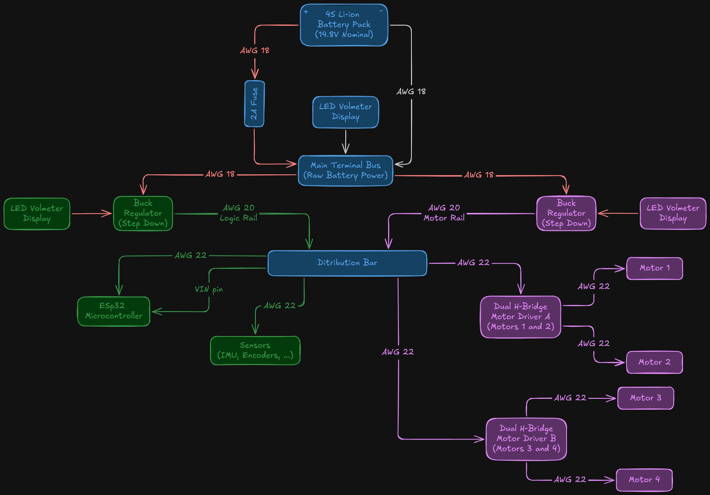
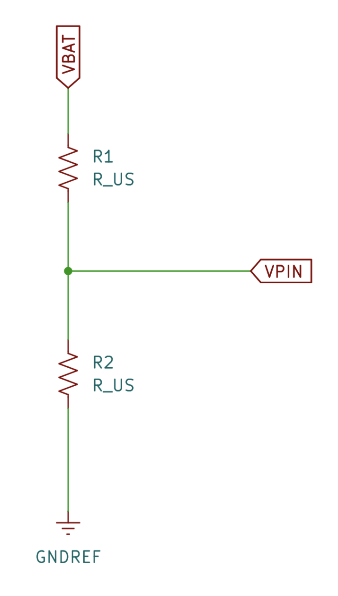
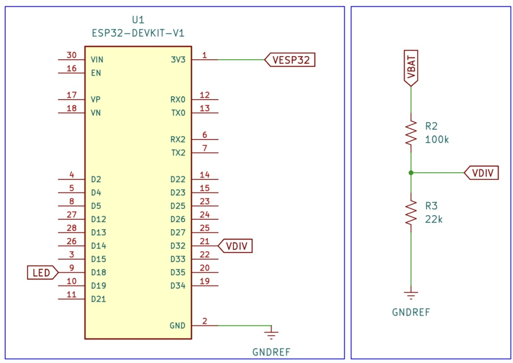
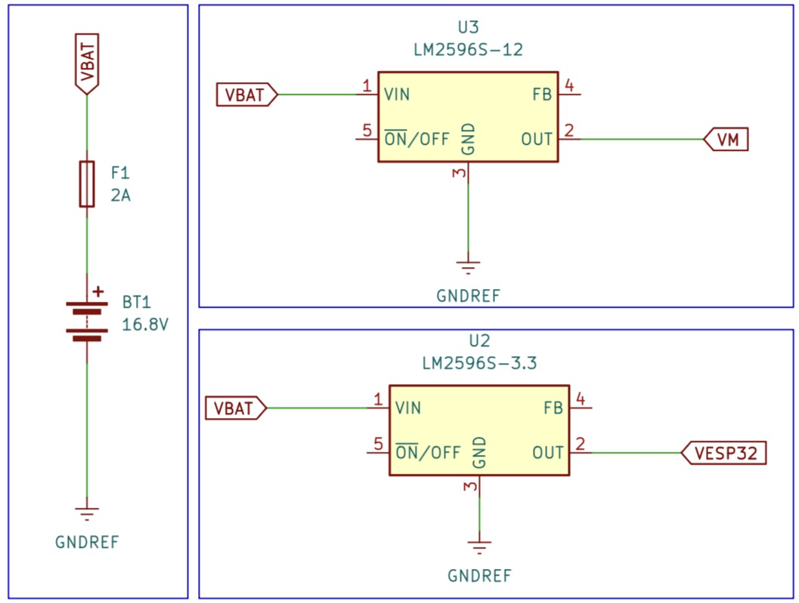
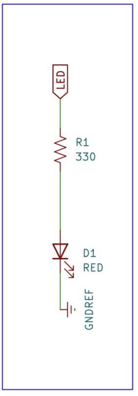

By: >_ terminal gremlin (c-lydia^-^)  
Chheng Lydiya

## Power Architecture and Dual-Rail Isolation



A mobile robot's power distribution network must reliably service two conflicting electrical loads:

- **Digital Logic Load (ESP32, Sensors, Communication):** requires a rock-solid, ultra-clean $5.00 V$ supply (stepped down internally by the ESP32 LDO to $3.3 V$) with minimal ripple ($< 5-0 mV$) and zero voltage drops below $2.8 V$
- **Electromechanical Actuator Load (Motors):** draws aggressive, discontinuous current pulses ($250 mA$ continuous $> 3 mA$ total chassis stall) and injects inductive back-EMF spikes into supply lines

### Why Dual Switching Buck Regulators Are Required

A single voltage regulator supplying both logiv and motors will fail during active driving. When motors start or stall, supply voltage drops rapidly due to internal battery resistance and wire impedance. If the voltage feeding the microcontroller dips below the $2.8 V$ brownout detector threshold, the internal reset cricuit asserts `rst: 0x10 (RTCWDT_RTC_RESET, boot: 0x13, SPI_FAST_FLASH_BOOT)`

By utilizing **two independent adjustable switching buck regulators** (LM2596 or MP1584 step-down modules):

- **Buck Regulator 1 (Clean Logic Rail at $5 V$):** dedicated exclusively to the ESP32 `VIN` pin and HC-SR04 ultrasonic sensor power. It operates with continuous high efficiency and zero motor noise contamination
- **Buck Regulator 2 (Motor Rail at $6 V$):** dedicted exclusively to the power stages (`VM`) of the two red dual H-bridge motor drivers. It deliverss optimal $6 V$ power to the motors

### Li-Ion Battery Pack Mechancs and Regulator Headroom

The robot power source consists of four 18650 Lithium-Ion cells connected in series (4S1P configuration):

- **Fully Charged Voltage:** $4.2 V \cdot 4 = 16.8 V$
- **Nominal Voltage:** $3.7 V \cdot 4 = 14.8V$
- **Discharged Cut-Off Threshold:** $3 V \cdot 4 = 12 V$

#### Understanding Switching Regulator Dropout Headroom

Adjustable buck regulators require a minimum input-to-output voltage differential known as **dropout voltage** (typically $\Delta V_{dropout} \approx 1.5 V - 2 V$ for LM2596 step-down converter)

To guarantee a stable $6 V$ output on buck 2 across the entire discharge cycle: $$V_{in, min} \ge V_{out} + V_{dropout} = 6 V + 1.5 V = 7.5V$$

A fully discharged 4S battery pack sits at $12 V$, which comfortably exceeds the $7.5 V$ minimum requirement. This ensures both buck regulators remain in crisp regulation from 100% down to 0% battery capacity.

### Overcurrent Protection and Star Grounding Topology

- **2A Inline Safety Fuse:** installed on the AWG 18 main positive line immediately adjacent to the battery holder. If a tool accidentally shorts the primary screw terminals or a motor driver MOSFET fails short, the 2A fast-blow fuse melts within milliseconds, preventing cell thermal runaway or wire insulation fire
- **Screw Terminal Star Bus:** high-current motor currents must return directly to the battery negative lead through screw terminals using heavy-guage wire (AWG 18 or 20). High motor currents must never be routed through breadboard tracks or thin jumper wires.

## Analog Signals, Voltage Dividers and ADC Mechanics

To prevent lithium battery over-discharge (whicch permanently damages cell chemistry), the ESP32 must continuously measure the 4S battery voltage ($12 V - 16.8 V$)

### Resistive Voltage Divider

Because ESP32 GPIO pins operate at a maximum safe voltage of $3.3 V$, connecting $16.8 V$ directly to a pin will destroy the silicon. A passive **resistive voltage divider** scaled the battery voltage down to a safe range



The output voltage equation for an unloaded voltage divider is $$V_{out} = V_{in} \cdot \frac{R_{2}}{R_{1} + R_{2}}$$

Selecting precision metal-film resistor values $R_{1} = 100 k\Omega$ and $R_{2} = 22 k\Omega$, we have

- **Divider Attenuation Ratio ($K_{div}$):** $$K_{div} = \frac{R_{2}}{R_{1} + R_{2}} = \frac{22 k\Omega}{100 k\Omega + 22 k\Omega} = \frac{22}{122} \approx 0.1803278$$
- **Maximum Output Voltage at Full Battery ($16.8 V$):** $$V_{out, max} = 16.8 V \cdot 0.1803278 \approx 3.0295 V$$
- **Output Voltage at Discharged Threshold ($12 V$):** $$V_{out, min} = 12 V \cdot 0.1803278 \approx 2.1639 V$$
- **Quiescent Divider Current Draw ($I_{div}$):** $$I_{div} = \frac{V_{bat, max}}{R_{1} + R_{2}} = \frac{16.8 V}{122,000 \Omega} \approx 0.1377 mA$$
This minimal $138 \mu A$ current draw causes zero measurable parasitic drain on the battery pack

> Safety verification: $3.0295 V \le 3.3 V$, providing a comfortable $270 mV$ safety margin below the absolute maximum pin rating

### Input-Only Pin Selection (GPIO 32 or GPIO 34)

The voltage divider output is connected to `GPIO 32` (or `GPIO 34`). These input-only pins (GPIs) lack internal output driver transistors and internal pull-up or pull-down resistors, making them ideal high-impedance inputs for analog sensing.

### ESP32 12-Bit Successive Approximation Register (SAR) ADC

The ESP32 integers two 12-bit SAR ADC peripherals (ADC1 and ADC2)

> **Important Constraint:** ADC2 is shared with the Wi-Fi subsystem. When Wi-Fi is active, `analogRead()` calls on ADc2 pin (`GPIO 0, 2, 4, 12-15, 25-27`) will fail or return corrupt data. Always route analog sensors to ADC1 pins (`GPIO 32-39`)

#### Resolution and Attenuation

- **Resolution:** 12 bits yields $2^{12} = 4086$ discrete digital counts ($0-4095$)
- **Default Attenuation (`ADC_ATTEN_DB_11` or `ADC_ATTEN_DB_12` in v3.0+):** configures the internal input attentuator to accept full-scale input voltage up to $\approx 3.3 V$
- **Quatization Step Size ($q$):** $$q = \frac{V_{ref}}{\text{Total Steps}} = \frac{3.3 V}{4095} \approx 0.80586 {mV/count}$$

#### Inverse Reconstruction Equation

To calculate the physical battery voltage ($V_{bat}$) from raw ADC digital counts ($N_{adc}$):

1. **Calculate pin voltage ($V_{pin}$):** $$V_{pin} = \frac{N_{adc}}{4095.0} \cdot 3.3 V$$
2. **Multiply by inverse divider ratio ($K_{inv}$):** $$K_{inv} = \frac{R_{1} + R_{2}}{R_{2}} = \frac{122}{22} \approx 5.54545$$ $$V_{bat} = V_{pin} \cdot K_{inv} = \frac{N_{adc}}{4095.0} \cdot 3.3 V \cdot 5.54545 = N_{adc} \cdot 0.00446886 V$$

## Signal Conditioning and Exponential Low-Pass Filtering

High-frequency switching noise from buck regulators ($150 kHz$) and brush commutating noise from motors introduce high-frequency voltage spikes onto DC analog signals. If raw ADC readings are used directly, voltage telemetry will jump erratically, triggering false low-battery alarms.

### Discrete Exponential Moving Average (EMA) Low-Pass Filter

To smooth analog signals without consuming substantial memory buffers (liek large moving-average arrays), embedded system utilize a **1-line exponential low-pass filter**: $$y[k] = \alpha \cdot x[k] + (1.0 - \alpha) \cdot y[k - 1]$$where:

- $x[k]$ is the new raw incoming ADC sample at time step $k$
- $y[k]$ is the new filtered output value
- $y[k - 1]$ is the previous filtered output value from time step $k - 1$
- $\alpha$ is the smoothing coefficient ($0.00 < \alpha \le 1.0$)

### Selecting the Smoothing Coefficient ($\alpha$)

The smoothing factor $\alpha$ sets the balance between noise rejection and responsiveness:

- **$\alpha = 1.00$:** zero filtering ($y[k] = x[k]$); maximum noise, zero phase delay
- **$\alpha = 0.5$:** heavy weighting on new sample (50% new, 50% history); light filtering
- **$\alpha = 0.1$:** optimal battery foltering (10% new, 90% history); eliminates high-frequency ripple while providing smooth tracking
- **$\alpha = 0.01$:** heavy filtering; ultra-smooth output, but introduces noticeable response lag

## Buck Calibration

> Safety: do not connect ESP32 `VIN` pin or motor driver power terminals until completing these checks

### Pre-Power Continuity and Fuse Check

- Verify $2A$ inline fuse is installed in battery holder positive lead
- Set Multimeter to Continuity Mode. Confirm $0 \Omega$ connection from battery negative to bus

### Primary Battery Voltage Check

- Insert 4 battery cells into holders. Set Multimeter to DC Voltage Mode ($20 V$ range)
- Probe primary screw terminals. Confirm raw battery voltage reads $14.8 V$ to $16.8V$
- Verify Mini Display 1 ($V_{bat}$) illuminates and match Multimeter reading within $\pm 0.1 V$

### Calibrate Buck Regulator 2 (Logic Rail: $5 V$)

- Probe Buck 1 output screw terminals with Multimeter DC Voltage Mode
- Rotate multi-turn brass potentiometer screw counter-clockwise using a screwdriver until Multimeter reads EXACTLY $+ 5 V$ DC ($\pm 5 V$)
- Verify Mini Display 2 ($5 V$ Logic) illuminates and reads $5.0 V$

### Calibrate Buck Regulator 2 (Motor Rail: $6 V$)

- Probe Buck 2 output screw terminals with Multimeter DC Voltage Mode
- Rotate multi-turn brass potentiometer screw until Multimeter reads EXACTLY $+ 6 V$ DC
- Verify Mini Display 3 ($6V$ Motor) illuminates and reads $6.0 V$

### Cross-Rail Isoltaion Check

- Disconnect battery pack. Set Multimeter to Resistance Mode ($200 k\Omega$)
- Measure resistance between $5 V$ Logic Rail and $6 V$ Motor Rail
- Confirm infinite resistance ($> 100 k\Omega$), proving physical power isolation

## Implementation: Power System

### How to Wire Power System




### Firmware

```cpp
#include <Arduino.h>

// Hardware pin definitions
const uint8_t PIN_PWM_OUTPUT = 18;       // PWM output or motor-driver input
const uint8_t PIN_HEARTBEAT_LED = 4;     // Dedicated status LED
const uint8_t PIN_BATTERY_ADC = 32;      // ADC1 input for battery divider

// LEDC hardware PWM configuration
const uint32_t PWM_FREQUENCY = 20000;    // 20 kHz PWM carrier
const uint8_t PWM_RESOLUTION = 8;        // 8-bit duty resolution: 0-255
const uint8_t LEDC_CHANNEL = 0;          // Hardware LEDC channel index

// Voltage-divider resistor values.
// The battery connects to R_TOP, and the ADC pin connects between R_TOP
// and R_BOTTOM. R_BOTTOM connects from the ADC pin to ESP32 ground.
const float R_TOP_OHMS = 100000.0f;      // 100 kOhm upper resistor
const float R_BOTTOM_OHMS = 22000.0f;    // 22 kOhm lower resistor

// Inverse divider ratio used to reconstruct battery voltage
const float DIVIDER_SCALE =
  (R_TOP_OHMS + R_BOTTOM_OHMS) / R_BOTTOM_OHMS;

// Exponential moving-average coefficient.
// Higher values respond faster but reject less noise.
const float FILTER_ALPHA = 0.15f;

// Battery safety thresholds for a 4S lithium-ion battery pack
const float V_BAT_EMPTY = 12.0f;         // 3.0 V per cell
const float V_BAT_FULL = 16.8f;          // 4.2 V per cell

// Scheduler timing intervals
const uint32_t INTERVAL_MOTION_US = 10000;   // 10 ms: 100 Hz motion task
const uint32_t INTERVAL_TELEMETRY_MS = 100;  // 100 ms: 10 Hz telemetry
const uint32_t INTERVAL_HEARTBEAT_MS = 1000; // 1 s: 1 Hz heartbeat

// Scheduler epoch timestamps
uint32_t last_motion_time_us = 0;
uint32_t last_telemetry_time_ms = 0;
uint32_t last_heartbeat_time_ms = 0;

// PWM state
uint8_t current_duty_count = 0;          // PWM duty value: 0-255
int8_t ramp_direction = 1;               // +1 accelerates, -1 decelerates

// Performance metrics
uint32_t loop_execution_time_us = 0;
uint32_t max_execution_time_us = 0;
int32_t loop_jitter_us = 0;

// Heartbeat state
bool heartbeat_state = false;

// Battery-sensing state
float raw_battery_voltage = 0.0f;
float filtered_battery_voltage = 0.0f;
float battery_percentage = 0.0f;
bool low_battery_flag = false;

// Initialize the ESP32 LEDC PWM peripheral
bool initHardwarePWM() {
  return ledcAttachChannel(
    PIN_PWM_OUTPUT,
    PWM_FREQUENCY,
    PWM_RESOLUTION,
    LEDC_CHANNEL
  );
}

// Write an 8-bit duty value to the PWM output
void setHardwarePWM(uint8_t duty_count) {
  ledcWrite(PIN_PWM_OUTPUT, duty_count);
}

// Read the battery voltage through the resistor divider.
//
// analogReadMilliVolts() uses the ESP32 ADC calibration data when available.
// This is more accurate than assuming every ADC count equals exactly 3.3 V.
float readBatteryVoltage() {
  const uint32_t pin_voltage_millivolts =
    analogReadMilliVolts(PIN_BATTERY_ADC);

  const float pin_voltage =
    pin_voltage_millivolts / 1000.0f;

  // Reconstruct the original battery voltage from the divider output
  return pin_voltage * DIVIDER_SCALE;
}

// Initialize the ADC and prime the moving-average filter
void initBatterySensing() {
  // Configure the ADC for 12-bit readings: values 0-4095
  analogReadResolution(12);

  // Configure the ADC input attenuation for the battery-divider voltage
  analogSetPinAttenuation(PIN_BATTERY_ADC, ADC_11db);

  // Take an initial sample so the filter does not begin at zero
  raw_battery_voltage = readBatteryVoltage();
  filtered_battery_voltage = raw_battery_voltage;
}

// Read, filter, and evaluate the battery voltage
void updateBatterySensing() {
  // Read the latest battery voltage measurement
  raw_battery_voltage = readBatteryVoltage();

  // Exponential moving-average low-pass filter:
  //
  // y[k] = alpha*x[k] + (1-alpha)*y[k-1]
  //
  // This suppresses fast switching noise and motor-current transients.
  filtered_battery_voltage =
    (FILTER_ALPHA * raw_battery_voltage) +
    ((1.0f - FILTER_ALPHA) * filtered_battery_voltage);

  // Convert the filtered pack voltage to a simple linear percentage.
  // This is an approximate voltage indicator, not a true state-of-charge
  // measurement because lithium-ion voltage depends on load and chemistry.
  if (filtered_battery_voltage <= V_BAT_EMPTY) {
    battery_percentage = 0.0f;
  } else if (filtered_battery_voltage >= V_BAT_FULL) {
    battery_percentage = 100.0f;
  } else {
    battery_percentage =
      ((filtered_battery_voltage - V_BAT_EMPTY) /
       (V_BAT_FULL - V_BAT_EMPTY)) * 100.0f;
  }

  // Assert the low-voltage warning after filtering
  low_battery_flag =
    filtered_battery_voltage < V_BAT_EMPTY;
}

// 100 Hz motion-control task
void taskMotionControl() {
  const uint32_t execution_start_us = micros();

  // Apply the current duty value to the hardware PWM peripheral
  setHardwarePWM(current_duty_count);

  // Reverse direction at the ramp endpoints
  if (current_duty_count == 255) {
    ramp_direction = -1; // Begin deceleration
  } else if (current_duty_count == 0) {
    ramp_direction = 1;  // Begin acceleration
  }

  // Update the duty value safely
  current_duty_count = static_cast<uint8_t>(
    static_cast<int16_t>(current_duty_count) + ramp_direction
  );

  // Measure execution time
  loop_execution_time_us = micros() - execution_start_us;

  // Track the worst observed execution time
  if (loop_execution_time_us > max_execution_time_us) {
    max_execution_time_us = loop_execution_time_us;
  }
}

// 10 Hz telemetry and battery-sensing task
void taskTelemetry() {
  // Update the ADC reading and low-pass filter
  updateBatterySensing();

  // Calculate theoretical PWM information
  const float duty_percent =
    (current_duty_count / 255.0f) * 100.0f;

  // This is the theoretical average voltage at the ESP32 GPIO pin.
  // It is not the motor voltage when an H-bridge driver is connected.
  const float theoretical_voltage =
    (current_duty_count / 255.0f) * 3.3f;

  // Use Serial.printf() for formatted output.
  // Serial.println() does not process printf-style format arguments.
  Serial.printf(
    "PWM_Duty: %u, Duty_pct: %.1f, Theoretical_V: %.3f, "
    "V_bat_Raw: %.2f, V_bat_Filt: %.2f, Bat_Pct: %.1f, "
    "Exec_us: %lu, MaxExec_us: %lu, Jitter_us: %ld\n",
    current_duty_count,
    duty_percent,
    theoretical_voltage,
    raw_battery_voltage,
    filtered_battery_voltage,
    battery_percentage,
    loop_execution_time_us,
    max_execution_time_us,
    loop_jitter_us
  );

  // Report the low-battery condition at the slower telemetry rate
  // instead of repeatedly printing from the fast control task.
  if (low_battery_flag) {
    Serial.println(
      "[ALARM] LOW BATTERY VOLTAGE BELOW 12.0 V"
    );
  }
}

// 1 Hz heartbeat task
void taskHeartbeat() {
  heartbeat_state = !heartbeat_state;

  digitalWrite(
    PIN_HEARTBEAT_LED,
    heartbeat_state ? HIGH : LOW
  );
}

// Arduino initialization function
void setup() {
  // Configure GPIO pins
  pinMode(PIN_PWM_OUTPUT, OUTPUT);
  pinMode(PIN_HEARTBEAT_LED, OUTPUT);
  pinMode(PIN_BATTERY_ADC, INPUT);

  digitalWrite(PIN_PWM_OUTPUT, LOW);
  digitalWrite(PIN_HEARTBEAT_LED, LOW);

  // Initialize the USB serial console
  Serial.begin(115200);
  delay(500); // Allow the serial interface to initialize

  Serial.println("POWER SENSING");

  // Initialize PWM
  if (!initHardwarePWM()) {
    Serial.println("[FATAL ERROR] Failed to initialize LEDC hardware");

    // Stop here if PWM initialization fails
    while (true) {
      delay(1000);
    }
  }

  // Start PWM at zero duty
  setHardwarePWM(0);

  // Initialize the battery ADC and divider measurement
  initBatterySensing();

  Serial.println(
    "[STATUS] Battery voltage divider initialized on GPIO 32"
  );

  // Initialize scheduler epochs
  const uint32_t now_us = micros();
  const uint32_t now_ms = millis();

  last_motion_time_us = now_us;
  last_telemetry_time_ms = now_ms;
  last_heartbeat_time_ms = now_ms;

  Serial.println("[STATUS] Power-monitoring scheduler started");
}

// Main Arduino loop
void loop() {
  const uint32_t current_time_us = micros();
  const uint32_t current_time_ms = millis();

  // 100 Hz motion-control task
  if ((uint32_t)(current_time_us - last_motion_time_us) >=
      INTERVAL_MOTION_US) {

    // Measure actual task-period timing
    const uint32_t actual_period_us =
      current_time_us - last_motion_time_us;

    // Calculate deviation from the nominal 10 ms period
    loop_jitter_us =
      static_cast<int32_t>(actual_period_us) -
      static_cast<int32_t>(INTERVAL_MOTION_US);

    // Preserve the absolute scheduling grid.
    // Unsigned subtraction handles micros() rollover correctly.
    last_motion_time_us += INTERVAL_MOTION_US;

    taskMotionControl();
  }

  // 10 Hz telemetry and battery-sensing task
  if ((uint32_t)(current_time_ms - last_telemetry_time_ms) >=
      INTERVAL_TELEMETRY_MS) {

    // Preserve the absolute scheduling grid
    last_telemetry_time_ms += INTERVAL_TELEMETRY_MS;

    taskTelemetry();
  }

  // 1 Hz heartbeat task
  if ((uint32_t)(current_time_ms - last_heartbeat_time_ms) >=
      INTERVAL_HEARTBEAT_MS) {

    // Preserve the absolute scheduling grid
    last_heartbeat_time_ms += INTERVAL_HEARTBEAT_MS;

    taskHeartbeat();
  }
}
```

### Test

1. Connect the 4S battery pack to the main distribution screw terminals
2. Connect the USB cable to the PC. open the Arduino IDE **Serial Monitor** (`115200` baud). Confirm clean telemetry lines outputting at $10 Hz$
3. Open **Tools > Serial Plotter** (`Ctrl` + `Shift` + `L`). Observe the following traces:
	- **`V_bat_Raw`:** shows slight quatization ripple and noise from the buck converter
	- **`V-bat_Filt`:** displays a smooth, steady line tracking the actual pack voltage ($12.0 V - 16.8 V$)
	- **`Bat_Pct`:** indicates state of charge (0% to 100%)
4. Probe **GPIO 32** with the Multimeter in DC Voltage mode. Verify that physical pin voltage equals: $$V_{pin, measured} = \frac{V_{bat, meter}}{5.54545}$$

> Filtered battery voltage `V_bat_Filt` printed on Serial must mtch physical Multimeter readings taken directly across the battery pack terminals within $\pm 0.10 V$

### Debugging

#### Battery Voltage Reads $0.00 V$ or Is Drastically Lower Than Multimeter Reading

- The voltage divider ($100 k\Omega/22 k\Omega$) resistor leads or ground jumper may be disconnected from GPIO 32. Verify physical breadboard tie-points and solder joints
- Verify that the inverse scaling factor `K_INV` ($5.545455$) is applied to raw ADC readings in code: `(raw_adc/4095.0f) * 3.300f * K_INV`
- Confirm that the ADC pin attenuation is initialized to $11 dB$ (`analogSetPinAttenuation(PIN_BATTERY_ADC, ADC_11db)`), so the pin full-scale voltage covers $0 - 3.3 V$

#### Filtered Telemetry (`V_bat_Filt`) Is Extremely Noisy or Fluctuates Rapidly

- The exponential low-pass filter coefficient (`FILTER_ALPHA`) is set too high )e.g., $\alpha > 0.50$). Reduce `FILTER_ALPHA` to `0.15` to attenuate high-frequency switching noise from buck regulators and motor commutators
- Motor return currents may be flowing through breadboard logic ground paths, causing ground bounce. Ensure motor drivers connect directly to the main battery star ground terminal

#### Filtered Voltage (`V_bat_Filt`) Lags Physical Voltage Changes Too Slowly

- The filter correficient (`FILTER_ALPHA`) is set too low (e.g., $\alpha < 0.05$), introducing excessive phase lag during dynamic load changed. Increase `FILTER_ALPHA` to `0.15-0.3` to improve voltage tracking bandwidth

#### Low-Battery Alarm Triggers Unexpectedly During Acceleration

- Transient voltage sags occur across internal battery resistance when motors draw high inrush current. Ensure the alarm condition evaluates `filtered_battery_voltage` rather than instantaneous raw ADC spikes

## References

- [The Art of Electronics: Student manual  by Thomas C. Hayes and Paul Horowitz](https://physics.bu.edu/adlab_and_elab/wp-content/uploads/2023/03/Thomas-C.-Hayes-Paul-Horowitz-The-Art-of-Electronics-Student-Manual-Cambridge-University-Press-1989.pdf)
- [Making Embedded Systems: Design Patterns for Great Software by Elecia White](https://github.com/VaheDanielyan/UsefulBooks/blob/master/Elecia%20White%20-%20O'Reilly%20Making%20Embedded%20Systems%20(2011).pdf)
- [Feedback systems: An Introduction for Scientists and Engineers by Karl Johan Astrom and Richard M. Murray](https://www.cds.caltech.edu/~murray/books/AM08/pdf/am08-complete_22Feb09.pdf)
- [ADC Peripheral API Documentation by Espressif Systems](https://docs.espressif.com/projects/arduino-esp32/en/latest/api/adc.html)
- [GPIO Peripheral API Documentation by Espressif Systems](https://docs.espressif.com/projects/arduino-esp32/en/latest/api/gpio.html)
- [Espressif Centralized Documentation Platform (CDP) by Espressif Systems](https://documentation.espressif.com/en/documentList?eol=false)
- [Arduino Core for ESP32 Documentation by Espressif Systems](https://docs.espressif.com/projects/arduino-esp32/en/latest/index.html)
- [Arduino Language Reference by Arduino](https://docs.arduino.cc/language-reference/)